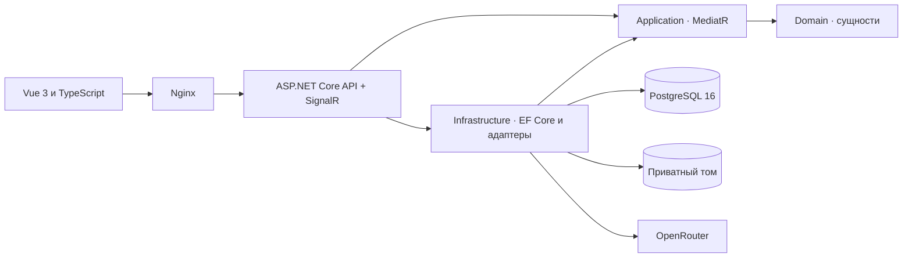
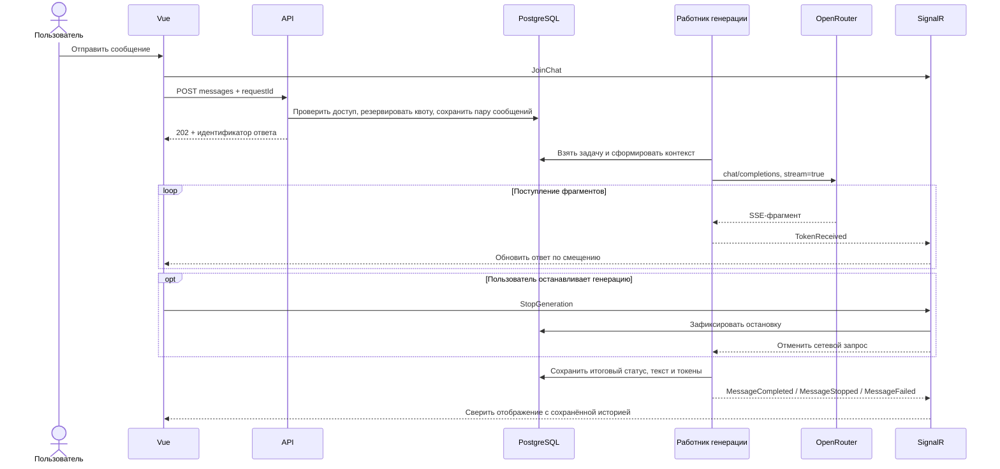
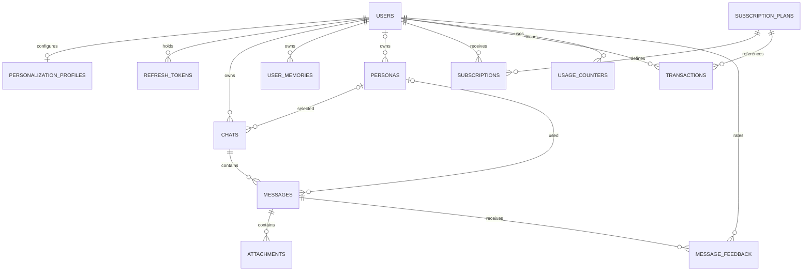

# Материалы для пояснительной записки

## Назначение системы

AI Helper Budz позволяет пользователю выбирать роль ассистента, управлять форматом ответов и самостоятельно задавать факты, которые могут использоваться в последующих диалогах. Автоматическое запоминание включается пользователем. Оценки ответов служат основанием для предложения изменить настройку длины.

В исходной версии Laravel сервер отправлял модели историю диалога и сохранял вложения в публичное хранилище. Версия на ASP.NET Core добавляет профиль, системные и пользовательские персоны, отбор релевантной памяти, резюме истории, приватные вложения и выдачу ответа через SignalR. Дневная квота хранится как количество запросов за дату UTC. Подписки задают доступ к моделям и пределы ресурсов. Демонстрационная транзакция хранит сумму и маску тестовой карты.

## Аналоги и выбор стека

| Система | Механизм персонализации |
|---|---|
| ChatGPT | Пользователь задаёт свои инструкции и может управлять сохранённой памятью. [Документация OpenAI](https://help.openai.com/en/articles/8590148-memory-in-chatgpt) |
| Claude Projects | В рабочей области проекта можно задавать инструкции и добавлять документы в базу знаний. [Документация Claude](https://support.claude.com/en/articles/9517075-what-are-projects) |
| Perplexity Spaces | Пространства объединяют тематические обсуждения, материалы и инструкции к ответу. [Документация Perplexity](https://www.perplexity.ai/en-GB/changelog/what-we-shipped-july-18th) |
| AI Helper Budz | Профиль, сменяемые персоны, редактируемые факты и предложение адаптации по оценкам доступны в одном пользовательском сценарии. |

C# задаёт типы для DTO, состояний и правил квот. ASP.NET Core объединяет API, аутентификацию и SignalR в одном сервере. EF Core позволяет версионировать схему PostgreSQL через миграции. Vue сохранён как основа интерфейса, а TypeScript проверяет контракт со стороны клиента.

## Компоненты и зависимости

Контроллеры валидируют транспорт и вызывают команды и запросы. Обработчики проверяют доступ к ресурсам и выполняют операции. EF Core задаёт внешние ключи и уникальные индексы. Транзакция блокирует строку пользователя на время резервирования запроса, смены тарифа и других связанных изменений. Сетевой вызов OpenRouter выполняется за пределами транзакции. Профиль и список персон для UI кэшируются на 30 секунд и инвалидируются после изменений. Сборщик контекста читает актуальные данные из PostgreSQL.

## Варианты использования

| Участник | Сценарии |
|---|---|
| Гость | Регистрация и вход |
| Пользователь | Настройка профиля, персоны и памяти. Отправка, остановка, повтор и редактирование сообщения. Загрузка файлов, оценка ответа, подтверждение адаптации. Просмотр тарифов и статистики. Управление аккаунтом |
| Администратор | Общая статистика, управление пользователями, тарифами и системными персонами. Просмотр диагностического контекста, когда он разрешён настройками окружения |
| OpenRouter | Потоковый ответ и учёт токенов. Извлечение фактов, резюме и предложения продолжения |

## Отправка сообщения и остановка

## Схема данных

Интересы хранятся в массиве профиля. Уникальность обеспечивается для нормализованных логина и email, пары «пользователь — нормализованный факт», оценки одного ответа, идентификатора повторной отправки чата и идентификатора демонстрационной транзакции. Квота имеет составной ключ `user_id, date`.

## Алгоритмы

1. Конструктор контекста берёт персону, профиль, релевантные факты, резюме, целые сообщения недавней истории и текущее сообщение с вложениями. Данные пользователя отделены от системных правил. Текущее сообщение входит один раз. Предельный объём задаётся по модели. Для текста используется консервативная оценка по байтам UTF-8 с резервом на ответ, а для изображения отводится отдельный резерв.
2. Память отбирается по совпадениям значимых слов текущего запроса с включёнными фактами его владельца. Пять наиболее релевантных фактов могут войти в контекст. Фоновая задача разбирает предложенные моделью факты, повторно проверяет согласие на автоматическую память и удаляет дубли.
3. Суммаризация начинается при превышении порога объёма или числа сообщений. Резюме привязывается к сообщению, заканчивающему раннюю часть диалога. При редактировании сообщения резюме сбрасывается и собирается заново.
4. Если среди последних пяти оценок больше половины относятся к причине «Слишком длинно» и получено минимум три оценки, система предлагает сократить ответы на один уровень. Пользователь может применить или скрыть предложение. Изменение применяется со следующей генерации.
5. Генерация при отправке, редактировании и регенерации резервирует запрос за дату UTC. Если ответ остановлен до начала выдачи или провайдер завершил запрос без текста, квота освобождается. Частичный ответ сохраняет списание. Полученные токены сохраняются за дату резервирования. После полуночи используется новая строка счётчика.

## Решения интерфейса

- Персона и модель выбираются в строке ввода. Панель параметров рядом с перепиской показывает, какая роль и какие настройки действуют в текущем диалоге.
- Рядом с формой персонализации меняется пример ответа. Он различает язык, уровень, длину и формат, поэтому настройки можно сравнить до сохранения. На мобильном экране есть переход к предпросмотру.
- Переписка оформлена как последовательность заметок с отдельной колонкой автора и времени. Блоки кода прокручиваются внутри сообщения. Цветовые сигналы сопровождаются текстом.

Снимки проверки размещены в [каталоге screenshots](screenshots/).
