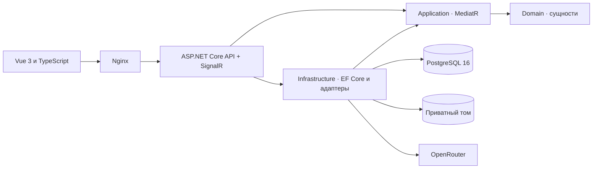
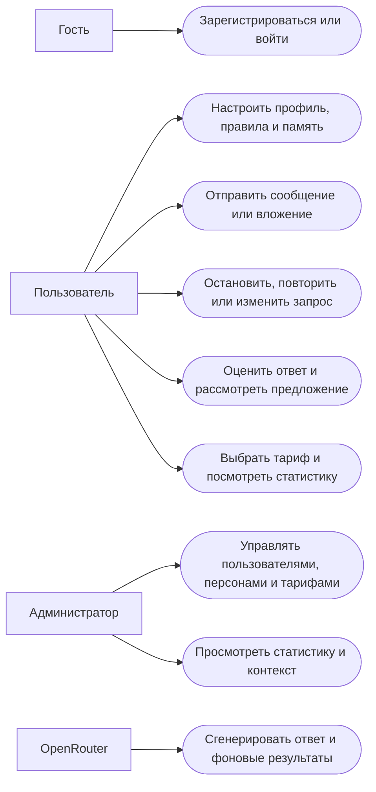
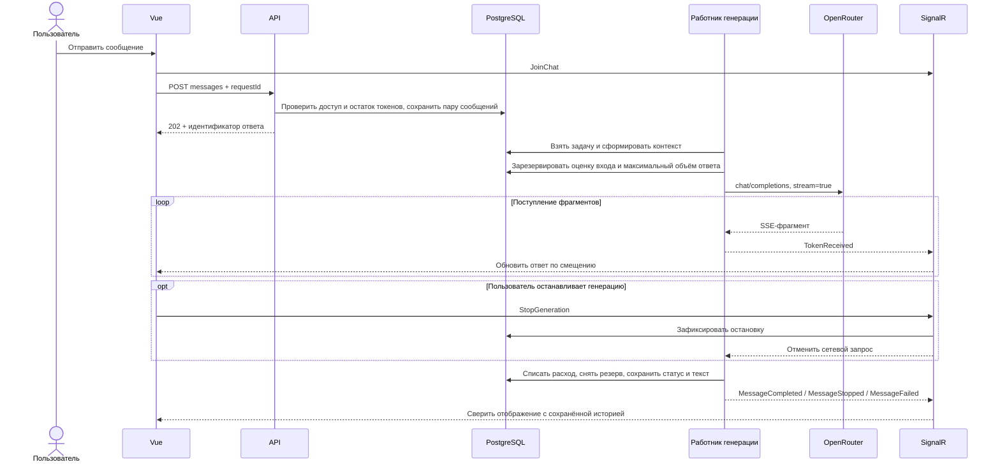
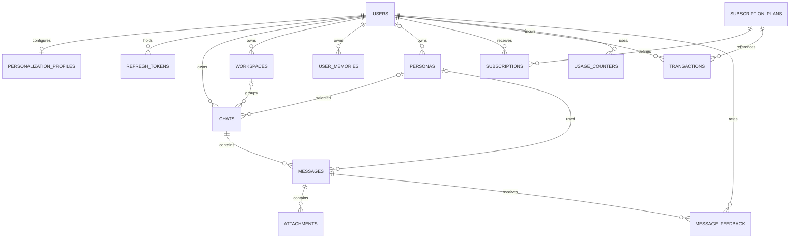

# Материалы для пояснительной записки

## Назначение системы

AI Helper Budz адаптирует ответы к типу запроса, цели пользователя и сохранённым предпочтениям. Пользователь самостоятельно редактирует правила и факты, управляет их использованием и отдельно включает автоматическое запоминание. Оценки ответов могут предложить изменить настройку длины.

В исходной версии Laravel сервер отправлял модели историю диалога и сохранял вложения в публичное хранилище. Версия на ASP.NET Core добавляет профиль, отбор релевантной памяти, резюме истории, приватные вложения и выдачу ответа через SignalR. Подписка определяет доступ к моделям, вложениям и дневной бюджет входных и выходных токенов. Каталог тарифов хранится в PostgreSQL. Демонстрационная транзакция хранит сумму и маску тестовой карты.

## Аналоги и выбор стека

| Система | Механизм персонализации |
|---|---|
| ChatGPT | Пользователь задаёт свои инструкции и может управлять сохранённой памятью. [Документация OpenAI](https://help.openai.com/en/articles/8590148-memory-in-chatgpt) |
| Claude Projects | В рабочей области проекта можно задавать инструкции и добавлять документы в базу знаний. [Документация Claude](https://support.claude.com/en/articles/9517075-what-are-projects) |
| Perplexity Spaces | Пространства объединяют тематические обсуждения, материалы и инструкции к ответу. [Документация Perplexity](https://www.perplexity.ai/en-GB/changelog/what-we-shipped-july-18th) |
| AI Helper Budz | Автоопределение типа задачи, правила по категориям, редактируемая память и предложение адаптации по оценкам. |

C# задаёт типы для DTO, состояний и правил квот. ASP.NET Core объединяет API, аутентификацию и SignalR в одном сервере. EF Core позволяет версионировать схему PostgreSQL через миграции. Vue сохранён как основа интерфейса, а TypeScript проверяет контракт со стороны клиента.

## Компоненты и зависимости

Контроллеры валидируют транспорт и вызывают команды и запросы. Обработчики проверяют доступ к ресурсам и выполняют операции. EF Core задаёт внешние ключи и уникальные индексы. Транзакция блокирует строку пользователя на время резервирования и списания токенов, смены тарифа и других связанных изменений. Сетевой вызов OpenRouter выполняется за пределами транзакции. Профиль для UI кэшируется на 30 секунд и инвалидируется после изменений. Сборщик контекста читает актуальные данные из PostgreSQL.

## Варианты использования

| Участник | Сценарии |
|---|---|
| Гость | Регистрация и вход |
| Пользователь | Настройка профиля, правил по категориям и памяти. Отправка, остановка, повтор и редактирование сообщения. Загрузка файлов, оценка ответа, подтверждение адаптации. Просмотр тарифов, остатка токенов и статистики. Управление аккаунтом |
| Администратор | Общая статистика, управление пользователями, тарифами и системными персонами. Просмотр диагностического контекста, когда он разрешён настройками окружения |
| OpenRouter | Потоковый ответ и учёт токенов. Извлечение фактов, резюме и предложения продолжения |

## Отправка сообщения и остановка

## Схема данных

Интересы и правила по категориям хранятся в профиле. Уникальность обеспечивается для нормализованных логина и email, пары «пользователь — нормализованный факт», оценки одного ответа, идентификатора повторной отправки чата и идентификатора демонстрационной транзакции. Счётчик расхода имеет составной ключ `user_id, date`. Резерв записывается в сообщение. При переходе на токены прежний лимит умножается на 2 048, а безлимитные тарифы сохраняют это свойство. Поле персоны сохраняет старые назначения в существующих диалогах.

## Алгоритмы

1. При включённой адаптации движок определяет тип запроса по признакам в тексте и учитывает предыдущий запрос для коротких продолжений. Для кода, обучения, работы с текстом, планирования и общих вопросов можно задать свою длину, формат и инструкцию. Если параметр для категории оставлен пустым, применяется общее предпочтение профиля. Явное указание в текущем запросе имеет приоритет над предпочтениями. Предпросмотр применяет те же правила к примеру пользователя с необязательным предыдущим запросом.
2. Конструктор контекста объединяет профиль, эффективные правила, релевантные факты, резюме, целые сообщения недавней истории и текущее сообщение с вложениями. Текущее сообщение входит один раз. Предельный объём задаётся по модели и остатку токенов. Вход оценивается по байтам UTF-8 с отдельным резервом на изображения. Память участвует в ответе при соответствующем разрешении. До пяти фактов выбираются по совпадениям с запросом. Фоновая задача разбирает предложенные моделью факты, повторно проверяет согласие на автоматическое запоминание и удаляет дубли.
3. Суммаризация начинается при превышении порога объёма или числа сообщений. Резюме привязывается к сообщению, заканчивающему раннюю часть диалога. При редактировании сообщения резюме сбрасывается и собирается заново.
4. Если среди последних пяти оценок больше половины относятся к причине «Слишком длинно» и получено минимум три оценки, система предлагает сократить ответы на один уровень. Пользователь может применить или скрыть предложение. Изменение применяется со следующей генерации.
5. Генерация при отправке, редактировании и регенерации резервирует токены за дату UTC. Для допуска нужен остаток от 900 токенов и достаточный бюджет для конкретного контекста. После завершения списывается сумма входных и выходных токенов из отчёта провайдера. При отсутствии отчёта текст ответа, включая частичный, учитывается по оценке. При отсутствии и текста, и отчёта резерв полностью освобождается. Фоновые задачи персонализации и резюме исключены из пользовательской квоты. Число запросов используется в статистике.

## Решения интерфейса

- Кнопка в шапке чата скрывает и открывает список диалогов. На широком экране чат занимает освобождённое место, а выбор сохраняется в браузере. На узком экране список изначально скрыт и закрывается при выборе диалога. Модель выбирается в меню диалога. Строка ввода начинается с одной линии, растёт до 142 px и дальше прокручивается внутри.
- Основная навигация расположена в центре шапки между названием Budz и профилем. На узких экранах она занимает второй ряд шапки. Остаток токенов отображается рядом с профилем.
- Редактор персонализации разделён на стиль ответа, правила задач и контекст с памятью. Готовый стиль меняет тон, уровень, длину и формат. Боковая панель сразу обновляет пример стиля, а проверка своего запроса показывает категорию, эффективные правила и использование предыдущей реплики. Проверка работает до сохранения и не запускает генерацию.
- Тема выбирается в онбординге и профиле и применяется сразу. Режим «Как в браузере» использует `prefers-color-scheme` и реагирует на смену темы без перезагрузки. Выбранный оттенок смешивается с базовыми цветами фона, панелей и акцентов светлой и тёмной схемы. Тема и оттенок хранятся локально в браузере.
- Переписка оформлена как последовательность заметок с отдельной колонкой автора и времени. Блоки кода прокручиваются внутри сообщения. Цветовые сигналы сопровождаются текстом.

## Проекты и данные

- Панель диалогов показывает проекты над общей историей. По нажатию на проект в основной области открывается список его диалогов. Запрос общей истории и запрос диалогов проекта используют отдельные параметры и пагинацию.
- Пространство связывается с диалогом по паре `workspace_id, user_id`. Команды проверяют владельца записи, а составной внешний ключ защищает назначения на уровне БД. При удалении пространства диалоги становятся личными. Перенос блокируется во время стриминга.
- В пространствах Budz добавляет инструкции и справочные материалы в пределах бюджета контекста. Общая память и автоматическое извлечение фактов отключены. Снимок применённых правил хранится отдельно от технического контекста и доступен владельцу ответа.
- Импорт разбирает внешний JSON в текстовые сообщения пользователя и ассистента. Он сохраняет видимый порядок, создаёт новые идентификаторы и отсеивает повторы по источнику. Внутренние сообщения провайдеров и исходные файлы исключены из переноса. Импорт не запускает генерацию.
- Временные диалоги исключены из списка, экспорта и фоновой адаптации. По истечении 24 часов доступ закрывается. Фоновая задача проверяет срок каждые десять минут и удаляет диалоги по той же процедуре, что и обычное удаление.

Снимки проверки размещены в [каталоге screenshots](screenshots/).
